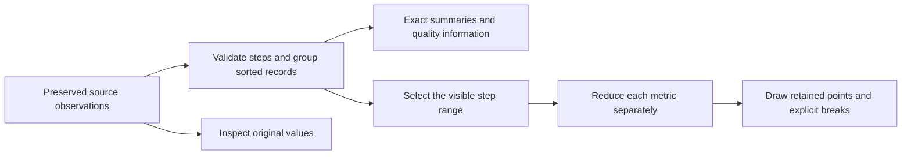

# Soup Monitor Build Approach

Current implementation direction, refined on 10 November 2026.

Build a small, explainable training monitor using explicit data rules and ordinary loops. Keep the original observations, reduce only what is drawn, and prove that the result preserves the evidence a person needs to inspect a run. This document records the direction to follow in later implementation sessions. Product acceptance criteria remain in [PRD.md](./PRD.md); precise data contracts and the measurement protocol remain in [TRD.md](./TRD.md).

Status: the dashboard, deterministic fixtures, typed-array preparation and exact summaries, per-metric viewport reduction, worker, and generated run-list catalog are implemented. The chart work adds independent raw-source validation, paginated exact inspection, a pure tested async session, separate source/load timestamps, and an overflow-safe linear chart model. The UI provides run search/filter/sort, three ECharts plots, shared range controls, and data-quality details. See [MOCK_DATA.md](MOCK_DATA.md) for fixture usage and [PRD_AUDIT.md](PRD_AUDIT.md) for current coverage. Targeted browser observations are retained separately from numerical and session tests. A browser baseline renderer, matched before/after 4x CPU traces, tab-memory measurements, full browser fault injection and assistive-technology checks, and deployment remain outstanding.

## Scope of the first implementation

- Use the existing Next.js App Router, TypeScript, npm, and CSS Modules setup.
- Generate exactly 20 repeatable synthetic runs. `run-020` has exactly 1,000,000 rows and a known isolated loss spike at step 500,000. The TRD defines the smaller anomaly fixtures.
- Provide a sortable/filterable run list and a detail view with loss, learning-rate, and gradient-norm charts, summary cards, data-quality notices, and loading/empty/error states.
- Use Apache ECharts with the Canvas renderer for plots, as requested on 10 November 2026, and ordinary HTML controls, labels, and a textual data inspector. Supply our reduced points with explicit breaks and disable built-in lossy sampling. Draw straight lines with linear axes. The first version has no smoothing or logarithmic mode; the zero/negative-value check verifies that these readings remain valid on a linear scale.
- Share the visible step range across all three charts. Start with keyboard-accessible zoom in/out/reset buttons, step-range inputs, and exact step inspection. Pointer inspection is included; elaborate drag gestures are optional.
- Retain the three separate metric charts. After reviewing the rainfall/flow example on 10 November 2026, no additional rainfall timeline or dual-axis area overlay is planned for this iteration. Introduce another visualization only when it resolves a concrete investigation need. Finish the gaps recorded in [PRD_AUDIT.md](PRD_AUDIT.md) first.

## Visual direction

The 10 November 2026 redesign uses black `#000000`, cream `#E6D5B7`, and orange `#F54F1B` for the interface. The user replaced the initial navy with black, then requested lighter chart panels and allowed additional line colors. Chart panels use charcoal `#141414`; loss uses warm orange `#FF794B`, learning rate blue `#82B1FF`, and gradient norm mint `#83CDA8`. Keep the canvas black, text cream, and selection cues orange. Primary buttons use cream with black text. The supplied slash icon is kept unchanged in `public/soup-icon.png` and `src/app/icon.png`.

Give space to the run data rather than workspace decoration. Remove redundant breadcrumbs, explanatory metric subtitles, repeated legends, and reassurance slogans. Keep actual snapshot time, latest reading states, quality warnings, visible-range controls, and exact source inspection. The run list shows latest step and loss. Explain the synthetic source once in an accessible disclosure, and explain point selection on demand. Meaningful warnings and accessible names are not decorative copy.

## One data pipeline

Small pure modules separate generation, preparation/summaries, reduction, inspection, and formatting from React and drawing. Explicit reading states and point/break tuples make the numerical decisions testable without a browser. The generated catalog supplies list summaries without allocating every run's dataset. `npm run data:catalog` uses the same generator and preparation module as the worker; `npm run data:catalog:check` fails when the checked-in catalog is stale.

`npm run data:validate` adds a separate reference scan over preserved raw columns; it does not call preparation or reduction helpers to calculate expected facts. It checks summaries, visible domains, required extrema/endpoints, continuity, conflicts, provenance, and unchanged source bytes. Its retained report covers all 20 fixtures and deterministic adversarial seeds 1–40. Additional unit cases cover generated million-point viewports, malformed boundaries, pagination, and raw mode. These are finite correctness checks, not browser timing or memory measurements.

The `feature/data-validation` follow-up validates runtime source structure and relevant worker replies without rewriting broken telemetry. The independent audit now checks requested-to-returned viewport normalization and full inspected records rather than trusting returned geometry or only checking source indexes. Small sources are exhaustively inspected; large sources use bounded sampling with reported counts. Reports retain individual failures and exact replay commands (`--run` / `--seed`). See [data-validation evidence](../evidence/data-validation/verification.md). No fixture recipes, source bytes, chart design or numerical reduction policy changed in this follow-up.

## Rules for each data problem

| Condition | Numerical treatment | What the user sees |
| --- | --- | --- |
| `NaN` | Classify as invalid; retain its location; break only that metric's line. | Invalid-reading notice and an inspectable break. |
| Positive or negative `Infinity` | Classify as invalid; never use as a chart coordinate, axis bound, or finite summary value. | Explicit invalid type and a break. |
| Missing metric value | Preserve a missing state distinct from NaN and a valid zero. | Missing-reading explanation and a break. |
| Identical duplicate readings at one step | Collapse per metric for drawing; retain source records and counts. | Duplicate count; source values available for inspection. |
| Conflicting duplicate readings | Do not choose a winner. Break the affected metric's line and retain finite extremes at that step. | Conflict marker or labelled observed range; all original readings inspectable. |
| Unsorted steps | Validate and sort numerically by step, with source order as a stable tie-breaker. | A line following actual training steps, independent of arrival order. |
| Invalid step | Exclude from ordered plotting and metric summaries; retain the original row and its rejected source index. | Rejected-row count; detailed rejected-row inspection remains a diagnostic concern. |
| Missing expected steps | Use the run's declared sampling interval to detect a missing interval. | A disclosed gap; no connection across it. |
| Valid zero or negative reading | Preserve its value. | Its actual position on the linear axis. |
| Isolated spike | Preserve the bucket extremum at its original step. | A visible peak with an inspectable source value. |

Apply validity and duplicate rules independently to `loss`, `lr`, and `grad_norm`. An invalid loss must not erase a valid learning-rate sample at the same step. A finite-plus-NaN duplicate group is both a conflict and an invalid-data condition; its finite extreme stays visible while the line remains broken.

“Keep the latest duplicate” would require a reliable correction timestamp/revision and a deliberate product policy. The current fields provide neither. For example, two loss readings at step 500 with values 100 and 1 must not become a clean value of 1 solely because it was last in the input array.

## Viewport min-max reduction

Keep original data at full precision. On every committed zoom or chart resize, reduce the visible source interval again. Never repeatedly reduce an already reduced dataset.

1. Find the source groups in the inclusive visible interval using their sorted steps.
2. Define buckets by horizontal step position in the actual plot width. Start with one bucket per CSS pixel; do not use a fixed number of input rows per bucket for irregularly spaced data.
3. For each metric and continuous valid segment, scan each bucket and select the **first, minimum, maximum, and last** source observations. These are selections of existing points, not computed averages.
4. Remove repeated selections, then emit retained observations in their original step order with unchanged step/value pairs. The words first/minimum/maximum/last describe selection criteria, not drawing order.
5. Preserve segment breaks and conflict/gap annotations independently. Never remove invalid records and connect the remaining neighbors across the removed position.
6. Compute the metric's vertical domain from all visible raw finite observations with valid steps, including conflict extremes. Draw isolated valid points as markers and keep peaks visible at viewport edges.

For the bucket below, the original steps are part of the data:

| Step | Loss | Retention reason |
| --- | --- | --- |
| 4 | 2 | First |
| 5 | 100 | Maximum |
| 6 | 2 | May be omitted |
| 7 | 1 | Minimum and last |

The output is `(4, 2), (5, 100), (7, 1)`. It preserves the spike's exact location and value. Drawing the minimum before the maximum would reverse their order and change the apparent history.

Reduce all three metrics independently. Reusing only loss-selected indexes for every chart could remove a gradient-norm spike that occurs elsewhere.

For a continuous segment, a 1,000-pixel-wide plot needs at most roughly 4,000 selected points with this rule, often fewer. A bare min/max pair would be about 2,000, but the count is not a correctness guarantee. Many gaps, conflicts, and isolated points can increase the output.

If fragmentation exceeds the drawing budget, show disconnected finite minimum/maximum markers and quality counts per column with a clear explanation. Count all output entries, including conflict markers and annotations, toward the budget. Preserve exact extremum values and source references for inspection. Never meet a point limit by silently reconnecting gaps. Keep this fallback small; a second sophisticated chart mode is unnecessary.

The known isolated maximum survives every viewport that contains its step because it remains its bucket's maximum. Smaller local peaks can be omitted when a larger peak shares their bucket. The claim is extrema preservation for the stated cases, not lossless compression of every original detail.

## Keep displayed numbers tied to source data

Whole-run summary cards come from the full valid-step source history and remain unchanged by zoom. A latest invalid or conflicting observation is shown as that state; an earlier valid value is separately labelled with its actual step. Observed extrema include finite conflicting readings. Rows with invalid steps remain preserved and counted separately; they do not influence metric extents, latest readings, or metric quality totals.

Axis bounds use all finite valid-step source readings in the visible interval. Tooltip and keyboard inspection query source groups by step, rather than inventing values between retained chart vertices. If the pointer falls in a gap, identify the missing interval. The current inspector exposes nearest or explicitly entered steps and original readings; a complete per-pixel column inspector with local extrema and quality counts remains a later completion check.

Exact source inspection uses pages of at most 20 rows with original source indexes and a total count. `sourceOffset` is a nonnegative safe integer, rounded down to a page boundary and clamped to the selected group's last page. Changing step starts at offset zero; an obsolete step/page reply cannot replace the newest inspection.

Keep a consistent numeric policy across cards, axes, and inspection. Axis labels use spacing-aware precision, while exact source values remain available without rounding. The pure chart model maps source domains into bounded linear display coordinates, including subnormal values, neighboring representable numbers, and opposite finite extremes. Raw step/value dimensions are preserved. Pointer queries decode the display coordinate; the selection guide uses the same forward mapping. This is a display transform, not a change to source numbers or a logarithmic scale.

Each chart reports its measured drawable width after its actual tick-label padding. The shared reducer budget uses the narrowest plot, and a changed width requests a fresh frame. Per-chart width deduplication prevents unchanged geometry from repeatedly querying the worker.

The snapshot disclosure shows fixed `snapshotAt`/`sourceVersion` separately from ISO `loadedAt`, the successful retrieval time of the displayed snapshot. Retained content keeps its previous load time through reload failure. A successful replacement publishes its summary, frame, and load time together; zoom and hover do not update freshness metadata. UTC labels and summary export preserve the distinction.

## Performance and state management

The engine provides `buildFrame(prepared, viewport, "raw")` alongside its reduced mode. A browser baseline renderer and its measurements are not yet implemented. Before claiming a before/after improvement, connect the raw mode to a controlled main-thread baseline, preserve that source revision or comparison mode, and record both versions under the same conditions. Both versions must call the same numerical helpers; the baseline draws raw finite segments while the optimized version reduces drawing volume and changes computation location. A slow or failed baseline is still evidence; do not replace it with an undocumented smaller dataset.

For the final million-point path, one Web Worker owns the selected run's Float64 source columns. It performs generation, normalization, reduction, and source inspection. React receives only metadata, small summaries, inspection results, and reduced drawing data. Preserve the worker's source buffers; transfer only temporary result buffers.

Use ordinary visible-range scans initially. Do not introduce block indexes, multilevel summaries, a global state library, or a backend unless measurements demonstrate a concrete need. Coalesce viewport requests so only the active request and the newest pending viewport need work. Redraw the hover overlay separately from the complete chart.

All async results carry run/version identity and request sequence. Viewport and inspection replies also carry their own revision/sequence. A change to the plot width increments the viewport revision even when the step range is unchanged; obsolete resize results must be rejected too. Reject stale results even if a request was cancelled. On a run change, terminate the old worker and clear its content. During zoom, retain the last complete frame with its matching axes and an updating state until the new three-chart result is ready.

`hooks/run-session.ts` implements this policy independently of React. The hook supplies the worker transport and lifecycle. Deterministic fake-worker tests exercise A/B/A switching, overlapping zoom/resize, stale inspection pages, mismatched identities, worker construction/message failures, retry, and failed refresh with retained content. Worker-boundary tests separately reject malformed requests. These tests establish those controlled sequences; browser-level fault injection and the full interaction/accessibility matrix remain required.

The development-only `/diagnostics/charts` route uses the real numerical pipeline and Canvas component with small handwritten scenarios, including extreme numbers and 45-row duplicate pagination. Production returned HTTP 404 in the recorded smoke check; this route is not the raw performance baseline. The [chart verification record](../evidence/charts/verification.md) covers the final passing integration check, reviewed diagnostic screenshots, 20-run source/DOM comparison, pagination, and targeted 360/768/1440px checks. Preserve those observations, failures, and follow-ups in `evidence/charts/`; the earlier dashboard evidence remains historical.

## Build sequence and completion checks

1. **Create deterministic fixtures and tiny handwritten oracles.** Verify the 20-run manifest, exact million-row count, known spike, and anomaly locations.
2. **Implement normalization and exact summaries.** Test invalid values, identical/conflicting duplicates, sorting, gaps, latest-reading states, and per-metric independence.
3. **Build the list, detail view, and a truthful baseline renderer.** Include summary cards, loading/empty/error states, native range controls, and textual inspection. Preserve the baseline and capture its production-build measurements.
4. **Implement and test the viewport reducer.** Check source positions, chronological output, first/last points, extrema, gaps, singleton segments, and viewport boundaries. Add a gradient-only spike case to catch shared-index mistakes.
5. **Move the selected run's heavy work into a worker.** Add request identity checks, atomic frame/axis updates, retry handling, and memory cleanup. Keep numerical behavior identical to the tested reference functions.
6. **Verify actual browser behavior.** Test rendered spike visibility, clipping, gap breaks, axis/tooltip agreement, narrow layouts, keyboard navigation, and rapid run/zoom/hover changes. Check stale snapshot metadata, locale/timezone independence, and zero/negative values on the linear scale.
7. **Capture comparable performance evidence.** Use the TRD protocol for first chart, zoom, hover, and tab memory at 1M points, with 4x CPU throttling for timing. Keep before/after raw output and failures. Optimize further only where measurements identify a problem.
8. **Prepare the assignment delivery.** Deploy and smoke-test when working on the delivery phase, write the required short note and actual reflection, record AI use honestly, and issue SHIP or DON'T SHIP from the evidence.

The reducer's output tests do not establish that pixels were painted correctly. Browser tests do not cover every possible viewport or device. Performance budgets remain targets until measured. Keep these limits explicit in the final evidence note.
