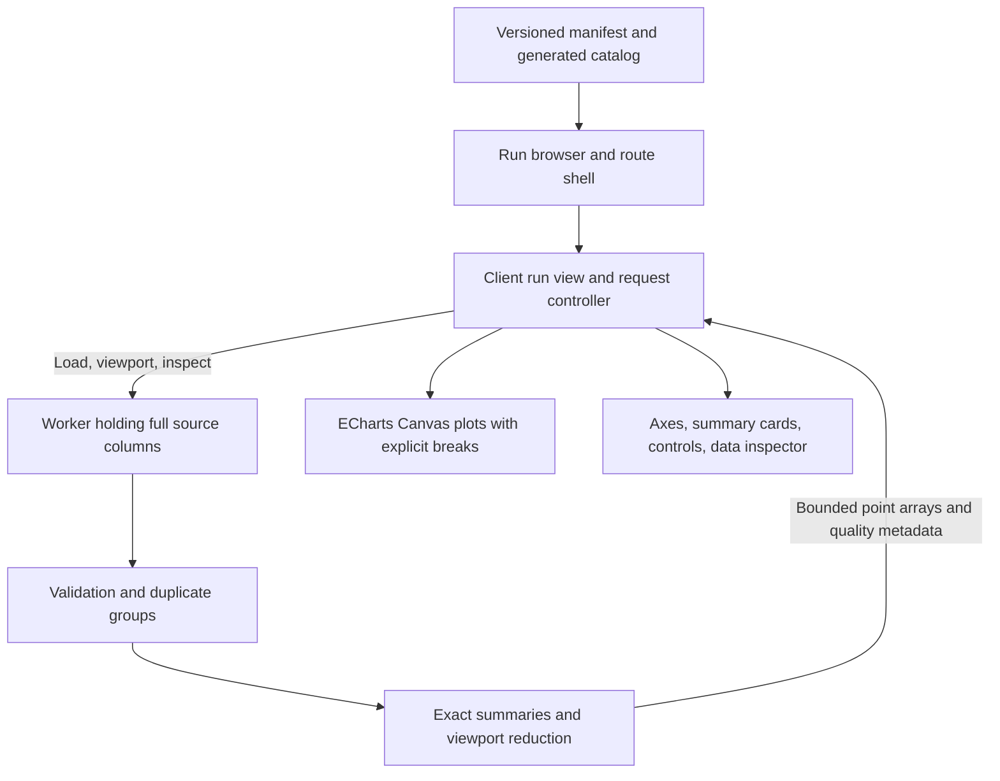

# Soup Training Run Monitor Technical Requirements

Version 1.7 · 10 November 2026 · Status: core dashboard and comparison harness implemented; 597-test production check passed, performance evidence incomplete

This specification defines how to implement and verify a training-run monitor whose charts remain trustworthy with malformed or dense records. The application includes deterministic fixtures, typed-array preparation, exact summaries/reduction, worker queries, runtime contracts, a catalog, source/column inspection and explicit failure recovery. `pref/optimization` adds both loss-sort directions, a distinct empty-catalog state, focus recovery and an opt-in raw/reduced browser comparison harness. The final `npm run check` at `d8192b0` passed 597 tests in 19 files, lint, strict types, all 20 exact catalog summaries and a production build; see [current verification](../evidence/optimization/verification.md). The historical [silent-failure checkpoint](../evidence/silent-failers/verification.md) at `1aaeeca` records 585 tests, the independent source audit, nine Node locale/time-zone cases and targeted failure/recovery scenarios. Required before/after 4× CPU traces, actual hover timing and tab memory remain unmeasured. The user subsequently requested deployment of the public repository on GitHub Pages from `main`; publication and hosted checks are in progress.

Local production smoke at `1aaeeca` verifies diagnostic routes return 404 without their controls, all-invalid loss remains tagged NaN in the downloaded summary, the million-point spike is visibly retained and exactly inspectable, and the 360px page has no horizontal overflow. This does not replace the full browser matrices or deployed-route check.

Current targeted browser checks add both loss-sort directions with unavailable values last, Enter-to-reset search focus, exact spike/next-step inspection, a three-step range, All steps reset and mobile drawer Enter/Escape focus recovery. Comprehensive router, browser locale, Canvas/DPR and assistive-technology coverage remains a stated limit, not an additional feature to invent before local use.

The product behavior and release criteria are in [PRD.md](./PRD.md). Assignment requirements come from *Soup-Task-05-Frontend-Engineer(1).pdf*, page 1, supplied at `/Users/vlat247/Downloads/Soup-Task-05-Frontend-Engineer(1).pdf`. Architecture, data policies, fixture allocation, and performance budgets below are engineering decisions, rather than constraints prescribed by the assignment.

Start implementation with [BUILD_APPROACH.md](./BUILD_APPROACH.md), which records the current direction and build sequence. Use ordinary numerical helpers, first/minimum/maximum/last reduction, Apache ECharts with its Canvas renderer, and linear-only unsmoothed plots initially. The user selected ECharts on 10 November 2026. Retain a truthful raw rendering mode for baseline comparison; add further indexing only when measurements justify it. The contracts below define the edge cases that this simple implementation must preserve.

## 1 Engineering objectives

1. Preserve evidence that could change a person's decision about a costly training run: spikes, invalid readings, ambiguous duplicate records, missing intervals, and stale snapshots.
2. Make normalization, reduction, rendering, summaries, and formatting independently testable. A fast chart is acceptable only if these layers agree.
3. Keep the main thread responsive with a million source records and avoid putting those records into React state or the server-rendered page payload.
4. Produce reproducible test and performance artifacts, including failures and the limits of the evidence.

The application supports inspection, not actual training termination. Authentication, a training backend, streaming ingestion, persistence, billing, smoothing, and multi-run chart overlays are outside the initial scope.

## 2 Stack and setup boundary

| Area | Decision | Reason |
| --- | --- | --- |
| Framework | Next.js App Router with React and strict TypeScript | Matches the requested stack; separates route shells from interactive charts. |
| Runtime and package management | Node.js 24.x and npm; committed `package-lock.json` | Makes local and deployment installations reproducible. |
| Styling | Global tokens and CSS Modules | Small dependency surface; no component library required for this task. |
| Quality checks | ESLint, TypeScript, unit tests, catalog consistency, production build | Checks source and numerical behavior and prevents stale run-list summaries. |
| Chart renderer | Apache ECharts Canvas renderer, tree-shaken line/scatter/grid components; HTML controls and inspection | User-selected visualization library; application controls sampling, gaps, raw axes, and exact inspection. |
| Computation | Dedicated Web Worker with typed arrays | Owns generation, preparation, summaries, reduction, and source inspection. |
| Tests | Vitest covers fixtures, independent source checks, numerical queries, worker boundaries, pure sessions, and ECharts coordinate geometry; browser automation and axe integration remain planned | Controlled session and SVG coordinate checks complement targeted Canvas observations, without certifying all browser interactions or accessibility. |
| Deployment target | GitHub Pages, selected by the user | A conditional static export generates the fixed run catalog beneath `/soup-tz/`; browser workers retain the interactive data path. |

`package.json` and the lockfile are authoritative for versions. `/` and `/runs` redirect to `/runs/run-001`; `/runs/[runId]` validates the manifest ID. Commands include `dev`, `build`, `start`, `lint`, `typecheck`, `test`, `test:watch`, `data:inspect`, `data:validate`, `validate:presentation`, `bench:reduction`, `data:catalog`, `data:catalog:check` and `check`. The independent source audit and nine-process Node presentation matrix are separate commands; the latter is not browser environment coverage. The dashboard provides loading/error/recovery feedback, shared ranges, quality details, source/column inspection and guarded summary export.

App Router configuration follows the [official Next.js installation guide](https://nextjs.org/docs/app/getting-started/installation). Keep browser APIs in client components or workers, not module initialization shared with server rendering. Do not fetch remote fonts during builds.

## 3 Architecture and ownership



The manifest describes 20 synthetic runs and fixed generator/source versions. `data/catalog.json` contains `{ id, summary }` entries with exact latest states, last unambiguous finite readings and their steps, extents, and quality counts. The run browser joins those entries to the versioned descriptors without loading point arrays. `scripts/generate-run-catalog.ts` processes one generated run at a time through `prepareRun`; `npm run data:catalog:check`, included in `npm run check`, fails if the committed JSON differs. Unavailable or invalid readings use explicit kinds and null values, never JSON nonfinite numbers. Keep catalog and manifest changes together.

A selected run gets one dedicated worker that owns its full source data. Its computed summary must agree with the same-version catalog. On a run switch, terminate the previous worker, clear previous run content, and create a new worker. This bounds active data ownership to one dataset and makes cancellation of synchronous worker computation reliable; browser reclamation can lag, so measure switch-time peaks.

React state holds route/filter/load state, small summaries, the bounded frame, and the selected inspection result. Full source columns and normalization indexes stay in the worker. ECharts instances remain behind refs; pointer events are coalesced to animation frames, and the selected-step overlay updates separately from the numerical frame. `run-session.ts` owns bounded request queues, identity checks, and atomic state transitions; `use-run.ts` connects that pure controller to React and the native worker transport.

### Implemented module boundaries

```text
src/
  app/
    page.tsx                       redirect to the first run
    runs/page.tsx                  redirect to the first run
    runs/layout.tsx                persistent run-browser shell
    runs/[runId]/page.tsx          validated run route
    runs/[runId]/not-found.tsx     unknown-run view
    diagnostics/charts/page.tsx   development-only chart cases
    diagnostics/silent-failures/  development-only controlled faults
  features/dashboard/
    dashboard-shell.tsx            search, filters, sorting, navigation
    run-dashboard.tsx              summaries, controls, quality, inspection
    column-inspection.tsx          source column disclosure and extremum actions
  features/runs/
    data/manifest.ts              20 fixture descriptors
    data/catalog.json             generated small list summaries
    data/generate.ts               seeded column generator
    model/types.ts                 source contracts
    model/view-types.ts            summaries, frames, inspection, worker protocol
    model/prepare.ts               sorted source indexes, groups, exact summaries
    model/buckets.ts               shared normalized viewport and exact integer buckets
    model/reduce.ts                viewport buckets and segment breaks
    model/inspect.ts               nearest source group and paginated raw readings
    model/inspect-column.ts        original column extrema, counts and gap intersections
    model/validate-column.ts       bounded column reply consistency checks
    model/format.ts                shared numeric and timestamp formatters
    model/export-summary.ts        guarded tagged-summary serialization
    worker/run.worker.ts           computation and query dispatcher
    hooks/use-run.ts               React lifecycle and native worker transport
    hooks/run-session.ts           pure async controller and request identity checks
  features/charts/
    chart-model.ts                 source/display mappings, ticks, options, zoom math
    metric-chart.tsx               ECharts lifecycle, measured plot width, pointer interaction
  features/diagnostics/            handwritten cases using the real chart pipeline
tests/
  unit/                           source, engine, worker, session, and chart-model checks
scripts/
  inspect-runs.ts                  source fixture diagnostics
  validate-runs.ts                 independent raw-source oracle and report
  generate-run-catalog.ts          reproducible metadata generation
  benchmark-reduction.ts           synchronous Node engine samples and output counts
evidence/
  mock-data/                      retained source-fixture verification
  dashboard-ui/                   earlier dashboard checks and browser observations
  charts/                         source/session/renderer checks and diagnostic evidence
  data-validation/                earlier runtime contracts and independent audit checkpoint
  downsampling/                   exact buckets, column inspection, Node and browser evidence
  silent-failers/                  deadlines, renderer recovery, presentation and fault checks
```

Create browser-test, performance, and submission artifacts as those checks are performed. Their absence must not be replaced with generated pass claims or invented results. Loading, empty-metric, and worker error states currently live in the dashboard/chart components rather than separate route files.

## 4 Source data and fixture contract

### Types and representations

The conceptual input record is `{ step, loss, lr, grad_norm }`. `step` is a nonnegative safe integer; metrics are JavaScript numbers, including deliberately generated `NaN` and signed infinities. Missing readings use a separate state. Preserve the difference between a missing reading, an invalid number, and a valid zero.

```ts
type Metric = "loss" | "lr" | "grad_norm";
type ReadingKind = "finite" | "nan" | "positive-infinity"
  | "negative-infinity" | "missing" | "conflict";

interface RunDescriptor {
  id: string;
  name: string;
  status: "running" | "completed" | "failed";
  seed: number;
  generatorVersion: string;
  sourceVersion: string;
  rowCount: number;
  expectedStepInterval: number;
  snapshotAt: string; // Fixed ISO 8601 UTC instant, including Z.
  scenario: string;
}

interface SourceColumns {
  step: Float64Array;
  loss: Float64Array;
  lr: Float64Array;
  grad_norm: Float64Array;
  // Per-metric byte masks distinguish missing from numerical NaN.
  missing: Record<Metric, Uint8Array>;
}
```

Use four Float64 columns to avoid changing metric precision while optimizing. Their payload for one million rows is 32,000,000 bytes, about 30.52 MiB. Three one-byte missing masks add about 2.86 MiB. Preparation allocates a `Uint32Array` source-order index, about 3.81 MiB for one million accepted rows, and a group-boundary index of about 3.81 MiB when every step is unique. Rejected source indexes are retained separately. These calculations cover the named arrays only, not browser/tab memory, temporary allocations, chart objects, or canvas backing stores.

Keep source row positions as provenance. The sorted index is an ordering over raw columns, so original values remain available without a second full copy of the dataset. Monotonic input uses an identity order and skips sorting; it still has a compact index. No million-element array of row objects is allocated by preparation.

`validate-source.ts` checks the runtime contract before preparation: required descriptor metadata, supported fixture recipe shapes, real ISO UTC timestamps, attached Float64 source columns, Uint8 masks, consistent lengths/counts, positive safe-integer cadence and binary mask entries. It does not coerce ordinary arrays or strings into numbers. Numeric NaN/infinity, missing payloads and invalid numeric steps are telemetry classifications, not malformed source structures. Validation does not rewrite source buffers or infer external-data cadence. Recipe shape validation does not establish that a recipe generated the supplied columns.

Generate points inside the worker from a small manifest and fixed integer PRNG. Formula, seed, anomaly locations, and generator version must reproduce the same data. Do not use ambient `Math.random()` or current time. Golden fixtures and manually specified expected values prevent tests from merely agreeing with the same faulty generator.

Do not serialize nonfinite raw metrics using ordinary JSON: `NaN` and infinities become `null`. Generate them in memory; raw export/network ingestion would require explicit tags and decode validation. The implemented summary export serializes already-tagged Reading states, preserving NaN/positive-infinity/negative-infinity/missing/conflict distinctions. `serializeSummaryExport` rejects any unexpected untagged nonfinite numeric payload; serialization/download failures receive a visible UI error. It is a summary export, not a lossless raw-column archive.

### Fixture allocation

The identifiers and allocation below are implemented in the versioned fixture manifest; exact row counts and injection locations are documented in [MOCK_DATA.md](MOCK_DATA.md). Most runs have 2,000 to 10,000 rows so their behavior is easy to inspect.

| Run IDs | Count | Required scenario |
| --- | --- | --- |
| `run-001` to `run-006` | 6 | Distinct clean convergence, plateau, oscillation, and slow-progress shapes. |
| `run-007` to `run-008` | 2 | Sustained loss divergence and high gradient norms. |
| `run-009` | 1 | Interior NaN loss and invalid final loss. |
| `run-010` | 1 | Positive and negative infinite loss readings. |
| `run-011` | 1 | Exact duplicate steps and metric values. |
| `run-012` | 1 | Conflicting duplicate steps, including finite-plus-NaN and finite extreme values. |
| `run-013` | 1 | Deliberately shuffled input order. |
| `run-014` | 1 | Missing step intervals with known cadence. |
| `run-015` | 1 | Combined gaps, shuffled rows, invalid readings, and duplicates. |
| `run-016` | 1 | Zero readings, including a learning-rate schedule reaching zero. |
| `run-017` | 1 | Negative loss values to test log-scale rejection without assuming all valid losses are positive. |
| `run-018` | 1 | Constant finite series and constant-axis edge cases. |
| `run-019` | 1 | All-invalid loss with usable learning-rate and gradient-norm series. |
| `run-020` | 1 | Exactly 1,000,000 rows, steps 0 through 999,999; one isolated loss spike at step 500,000. |

For `run-020`, the existing loss at step 500,000 is replaced with exactly `12`, while baseline loss stays below `2`; no row is added. Manifest and independent tests fix this oracle. Empty, singleton, invalid-step and extreme cases remain diagnostic/test-only outside the 20 fixtures. Controlled worker/renderer faults use the real dashboard without changing fixture mathematics.

## 5 Normalization and numerical policy

### Step validity and ordering

1. Classify invalid `step` values separately. Reject the row from the ordered chart and metric summaries, count it in `rejectedRows`, and preserve its source index and original columns. Do not coerce strings, round fractional steps, or replace invalid steps with zero. The dashboard discloses the rejected count; a detailed rejected-row UI is not implemented.
2. Order valid rows by `(step, sourceRowIndex)`. Selected points retain actual training steps, never array positions. The chart's internal bounded display coordinates are a reversible presentation mapping over those steps.
3. Group equal steps. For each metric independently, compare reading classes and values. All NaNs form the same invalid class; signed infinities remain distinct. Treat positive and negative zero as numerically equal for these metrics, while source inspection may retain their representation.
4. Identical readings within a step collapse into one plotted state and a disclosed duplicate count. A difference in any metric affects that metric only.

### Conflicting duplicates

A conflicting group has no single canonical metric value. Break the connected line at that step. Draw separate finite extreme markers or a clearly labelled **observed range** glyph at the exact step, and expose every original reading in a paginated inspector. Include finite conflict extrema in the y-domain and overall observed minimum/maximum. A finite-plus-NaN group remains a conflict and also contributes to the invalid-reading count.

Do not average conflicting records or choose whichever record arrived last. Neither policy is justified by the source. A conflict at the largest step produces a `Conflicting values` latest-reading state, not an arbitrary number. A separate last unambiguous finite reading may be shown with its actual step.

### Invalid readings and missing intervals

Nonfinite and missing readings never enter a Canvas coordinate, interpolation, zero fallback, or finite summary. Each creates a break for its metric. A known step gap occurs when adjacent unique steps differ by more than `expectedStepInterval`; break all affected metric paths and disclose the missing interval. Do not invent a cadence for future external data: an unknown cadence must remain unknown.

Every valid singleton segment needs a point marker because a path with only `moveTo` is invisible. Gap and invalid markers use a dedicated annotation lane or label, not y=0 in the metric plot. At coarse scales, aggregate their counts per pixel column with an inspectable warning; do not imply that a hidden gap is continuous data.

### Summaries

| Summary | Exact definition |
| --- | --- |
| Latest step | Largest valid unique step, independent of input order. |
| Latest metric | Reading state at that step, including invalid or conflict states. |
| Last valid metric | Last unambiguous finite group at or before the latest step, explicitly labelled with its step. |
| Observed minimum and maximum | Extrema of every raw finite reading attached to a valid step, including conflicting duplicates; invalid and missing readings excluded with counts disclosed. Rejected-step rows do not influence metric extrema. |
| Source count | Total input row count, including duplicates and rejected-step rows. |
| Chart step count | Number of valid unique steps. |
| Quality counts | Raw nonfinite and missing metric counts on valid-step rows, duplicate extra rows, conflicting steps per metric, rejected-step rows, and missing intervals; overlapping categories need not sum to the source count. Individual numerical invalid kinds remain available in inspection. |

Whole-run summaries do not silently change when zooming. If viewport summaries are later added, label their interval separately. All-invalid and empty inputs return explicit unavailable states, never `0`, `Infinity`, or an arbitrary axis domain displayed as a measurement.

## 6 Reduction and rendering contract

### Viewport algorithm

The viewport is an inclusive interval `[startStep, endStep]` shared by all three charts. Validate finite safe integers, clamp to the dataset, and handle a single-step viewport explicitly. `W` is the drawable width in CSS pixels after axis padding. Device pixel ratio scales the backing canvas, not the source step values.

The implemented chart component reports its actual container width minus the grid margins, including the margin derived from precise tick labels. The dashboard uses the minimum reported width across all three charts for the shared reduction budget. Both resize and changed label padding can request a new frame; unchanged integer widths are deduplicated. Domains come from raw visible valid-step readings, so changing only the point budget does not change the axis bounds.

1. Binary-search the normalized steps for the visible interval. Query at most one neighboring group on each side to support edge geometry; these neighbors cannot cross a gap or influence visible-only summary labels.
2. Derive each y-domain from all visible raw finite values, including conflict extrema, before reduction. Apply explicit padding and a stable constant-domain rule. Never take the domain from a lossy sample.
3. Assign visible integer samples to the exact rational column `floor((step - start) * W / (end - start))`, clamped to `[0, W - 1]`. Do not trust a rounded floating division/multiplication at an integer boundary. With span `S = qW + r`, column `c` starts at offset `c*q + ceil(c*r/W)`; these intermediates remain safe for supported widths. `createBuckets` corrects an approximate index against these thresholds and supplies the same inclusive integer bounds to inspection. The right endpoint belongs to the last column; single-step viewports use a centered marker. Fractional pointer coordinates use floating projection, while membership of integer source rows remains exact.
4. Reduce each metric independently; do not reuse loss-selected indexes for learning rate or gradient norm. Within each continuous valid segment and column retain first, minimum, maximum, and last sample indexes. Deduplicate repeated indexes and emit in original step order. Never emit in the artificial order first/min/max/last when the maximum occurred before the minimum.
5. Emit explicit path-break commands at every invalid, missing, gap, or conflicting group. Emit conflict extrema and quality annotations separately. Draw straight connections only within continuous finite segments; no smoothing curve or trend filter.
6. Clip paths to the plot area, but keep edge markers fully visible using plot inset or marker-aware clipping. Bound y-padding so large finite values do not overflow; reject a nonfinite computed transform rather than drawing misleading coordinates.

For a single continuous series this produces at most about `4W` retained samples plus edge handling. With `B` segment boundaries it is `O(W + B)`, not unconditionally `O(W)`. Arbitrarily alternating valid and invalid records cannot have every discontinuity represented as a separate line segment within a fixed pixel budget.

For excessive fragmentation, show disconnected finite minimum/maximum markers and missing/conflict counts per pixel column, labelled as an aggregate view. Explain the representation and offer zoom/inspection; a second sophisticated chart mode is unnecessary. Do not truncate break markers and connect the remaining vertices. A practical first threshold is `8W` proposed drawing primitives or payload entries per metric, counting line vertices, singletons, conflict markers, and break/quality annotations together. Above that threshold, aggregate every category into a bounded number of entries per pixel column; retain exact extrema values and source IDs plus category counts. Counting line vertices alone would leave an all-conflict series unbounded. Measure and tune the threshold without changing semantics.

The first implementation can scan visible rows in the worker for each completed zoom (`O(Nvisible)`), using binary search only to restrict the interval. Coalesce inputs and allow only one active reduction plus the latest pending viewport. If measured zoom performance misses its budget, add fixed-size block summaries containing exact extrema indexes, endpoint indexes, and break/conflict flags. Boundary blocks must still be scanned; indexes must never bridge internal breaks. Do not prebuild a large pyramid before evidence justifies it.

### What the spike guarantee means

The isolated fixture spike is the unique finite maximum. In any nonempty viewport containing its step, it is the maximum of its pixel bucket, so the reducer must retain it or include it in an explicitly labelled range glyph. The y-domain includes it. This is a mathematical invariant of this reduction rule, conditional on correct normalization, bounds, and rendering; it is not a claim that every original sample survives.

Test all supported zoom presets, widths, edge alignments, and several device pixel ratios, then use property-based tests over arbitrary containing intervals. Assert retained source identity and visible plot geometry, and add browser pixel assertions for the actual spike. An excluded spike must not affect the viewport domain or appear as an in-view observation. Finite screenshots cannot prove every possible browser scale or human perception; record that limitation.

### Display coordinates and exact inspection

`chart-model.ts` maps raw source domains into bounded linear display coordinates before supplying ECharts. The mapping uses an overflow-safe calculation for opposite finite extremes and handles a singleton step at the center. Constant metric domains get finite padding; subnormal and adjacent representable readings receive distinct ticks where representable. Tick labels describe source values, not normalized positions. Each series entry also retains its original step/value in separate dimensions; the renderer never writes normalized values back to source or summary data. Straight lines, explicit null breaks, isolated markers, conflict extrema, and the exact peak marker retain their existing semantics.

The installed ECharts coordinate engine is exercised in SVG server-rendering tests for finite geometry, edge visibility, tick coordinates, and pixel-to-source mapping at multiple widths. Canvas screenshots and targeted browser observations complement these assertions; they do not establish every DPR, font, device, or paint outcome.

Map the cursor to a raw step, then query the worker for the nearest unique source step, with a documented tie rule of the lower step. Do not report a reduced bucket's average or interpolate a measurement. Show the exact step and reading classification. If the cursor is inside a missing interval, say so; any nearest recorded point must be labelled as nearest, not sampled at the cursor.

Pointer conversion decodes the chart's normalized x coordinate back to the source interval without rounding before nearest-step selection. The selected-step guide uses the same model's forward mapping and grid margins. Integer wheel-zoom calculations are tested separately for narrow ranges and singleton boundaries.

`inspectColumn` exposes original finite extrema (including conflicts) with source step/index, raw finite/invalid/missing counts, conflicting step counts, duplicates and intersecting known missing intervals. Tied extrema select the earliest step then original source index. It binary-searches the column's integer interval and scans its source groups; neighboring groups reveal gaps in empty columns. Missing intervals intersect the continuous column band and remain distinct from absent metric readings. A column may have no integer steps, zero rows and still intersect a known gap. An exact query outside the committed viewport returns null column context, rather than substituting a nearby column.

The dashboard's collapsed column disclosure complements the exact observation inspector. Each minimum/maximum is a button to its original step. The shared budget uses the narrowest chart, so a reduction column is not claimed to equal one physical screen pixel in every chart. No source values are averaged or taken from reduced output; the column reply contains a constant number of records regardless of source size.

## 7 Worker protocol and asynchronous state

The implemented protocol in `model/view-types.ts` carries `runId` and a monotonically increasing `requestId` on every request and response. Rendered frames additionally carry `sourceVersion`, which the hook checks against the selected descriptor. A new viewport request ID covers both the step interval and drawable width, serving as the geometry revision; resize replies cannot commit under an older ID. Inspection requests also receive fresh IDs and are tracked separately. Changing viewport geometry invalidates pending inspection replies from the previous mapping.

| Request | Response | Main contents |
| --- | --- | --- |
| `load` | `loaded` or `error` | Exact whole-run summary and initial full-range frame; raw columns stay in worker. |
| `viewport` | `frame` or `error` | Interval/width, raw domains, points, null breaks, conflict extrema, representation mode, quality counts. |
| `inspect` | `inspection` or `error` | Requested step, optional `sourceOffset` and committed `viewport`; nearest group with lower-step tie rule, previous/next steps, provenance and at most 20 raw rows. When viewport is supplied, also return original column facts or null outside the range. |

`inspectStep(prepared, requestedStep, sourceOffset = 0)` accepts only a nonnegative safe-integer offset. It rounds down to a multiple of 20 and clamps to the last page of the selected group. `sourceOffset`, `sourceCount`, and original `sourceIndex` values let the UI show the current range and navigate every source row without unbounded DOM output. A 45-row group is covered by three pages in unit and diagnostic checks. Step/page and column facts share one latest-inspection identity and queue. The session attaches its committed viewport and validates returned column identity, bounds, counts and extrema. Zoom/resize clears prior column context before requesting new geometry; old replies cannot restore it. Legacy worker inspections without a viewport retain their exact-step-only response shape.

Validate payload discriminants and ranges at the worker boundary. Return a bounded error record rather than serializing an entire exception or dataset. Keep complete source arrays in the worker and transfer only temporary result buffers; transferring an `ArrayBuffer` detaches the sender's view, so a persistent source buffer must never be transferred accidentally. See [MDN transferable objects](https://developer.mozilla.org/en-US/docs/Web/API/Web_Workers_API/Transferable_objects).

The run view moves through `idle -> loading -> ready | empty | error`. A new run immediately invalidates old content and request IDs. Abort any in-flight fetch when available, terminate the old worker, and still reject responses whose identities do not match the active route. Cancellation alone is not the correctness check.

During same-run viewport updates, keep the last rendered frame and its matching axes under an `Updating chart` state until all three metric results for the new revision are ready. Commit them atomically. Never show new axis bounds over old plotted values. For refresh of the same run, retained content must be labelled as the previous snapshot; an error must leave a visible stale/error notice and retry action.

The implementation uses fixed `snapshotAt` and `sourceVersion` labels for the synthetic demo and records ISO `loadedAt` separately for the displayed successful retrieval. The snapshot disclosure shows both source time and last successful load in UTC; export includes the separate load time. A refresh retains the previous complete summary/frame/load time with `isPreviousSnapshot` until the replacement commits. If a resized initial frame is still pending, new summary and load time wait for that frame too. Failed refresh, zoom, and hover cannot make an old snapshot appear newer. No live-data promise or polling is implied. A future stale threshold would require a deliberate policy and injected clocks.

Sent requests receive a 30-second response deadline through an injectable scheduler; queued work starts its timer when sent. Reply/stop cleanup cancels timers, and identity checks guard already-queued callbacks. A timeout halts the session, clears pending work and retains any complete previous snapshot with a visible error and manual retry. Irrelevant/replayed replies cannot extend deadlines. Browser suspension or background throttling can delay timer execution; this is a recovery policy, not a real-time guarantee.

Pure session tests supply fake workers, clocks and schedulers for A/B/A switches, held/replayed replies, coalescing, malformed data, worker failures, deadlines and cleanup. Targeted development-browser fault scenarios complement these tests; full router races and scheduling coverage remain separate.

`validate-view.ts` checks relevant current replies before publishing them: tagged reading states, summary accounting, metric containers, finite coordinates/domains, drawing budgets, full-range summary agreement, and bounded source pages. Finite inspection values must remain inside whole-run source extents; latest-step inspection must agree with the latest summary. Stale identities are discarded before deep validation. A malformed current payload stops that session without replacing a retained complete snapshot, and malformed error text receives a bounded fallback. These structural and consistency guards do not independently prove every returned value came from the source; the raw-source oracle provides separate evidence.

## 8 Routes and interaction design

`/` and `/runs` redirect to the first run. The shared run-browser shell provides name/ID search, status and quality filters, and fixed sort options: run ID, name, last step descending, and last unambiguous finite loss ascending. Loss sorting exposes that reading's value and actual step; latest invalid/conflicted states remain visible in the run detail. Runs with no unambiguous finite loss go last, with stable run IDs breaking numerical ties. If reverse sort directions are added, unavailable readings must still remain last. Preserve filter/sort state across detail navigation.

`/runs/[runId]` validates membership in the manifest and returns a meaningful unknown-run state for invalid IDs. The detail view shows run metadata, whole-run summaries, quality notices, and separate loss, learning-rate, and gradient-norm plots sharing a step interval. It never claims that one y-axis unit applies to all three metrics.

`/diagnostics/charts` is development-only and reuses the numerical pipeline/Canvas component for handwritten source edge cases. `/diagnostics/silent-failures` is also development-only: it wraps real worker replies and chart drawing with hold/fail/drop/corrupt controls, A/B component selection and hide/show controls, plus an event log and replay steps. It uses a 10-second diagnostic deadline. These are correctness aids, not a browser performance baseline or comprehensive router/browser automation.

Provide zoom in/out/reset buttons and labelled start/end step inputs. Pointer wheel or drag zoom may be added, but the native controls remain sufficient. Arrow-key sample navigation, Home/End, and exact step inspection operate when the chart inspector has focus and must not hijack typing in form controls. Escape dismisses an inspector without losing focus. Shared viewport changes retain deliberate focus.

Test layouts at 360, 768, and 1440 CSS-pixel widths, plus browser text zoom. Charts resize through `ResizeObserver`; redraw once per frame and recompute buckets for the actual plot width. Cap or manage backing-canvas DPR if memory measurements require it, and document the setting.

The renderer controller publishes a model only after drawing succeeds. Creation, draw, resize or coordinate failures remove the failed surface and selection guide and expose Retry chart; other metrics and source inspection remain available. Zero-sized containers release the renderer and render the latest desired model after regaining size. Tests cover lifecycle and failure transitions; the development browser verifies loss-only draw failure, Enter-to-retry and hide/show recovery.

Canvas has a textual alternative: metric name, interval, summary, quality description, and an accessible sample inspector. Use native buttons, inputs, table headings, `aria-sort`, visible focus, and concise live announcements for load/error/selection changes. Do not announce every pointer event. Target normal text contrast of at least 4.5:1 and necessary chart/control graphics of at least 3:1. Validate these against [W3C text contrast guidance](https://www.w3.org/WAI/WCAG22/Understanding/contrast-minimum.html), [non-text contrast](https://www.w3.org/WAI/WCAG22/Understanding/non-text-contrast.html), and [keyboard guidance](https://www.w3.org/WAI/WCAG22/Understanding/keyboard.html); automated checks alone do not establish accessibility conformance.

## 9 Numeric formatting and scale behavior

Use consistent numeric policy across lists, summaries, ticks and inspection. `format.ts` handles UI values; `chart-model.ts` chooses tick-spacing precision. Comparisons and positions use raw numbers. Compact scientific labels fall back to full precision when rounding would overflow a finite value. `formatExactValue` preserves full numeric text and signed zero, including exact table values and source titles. Small nonzero readings use scientific notation when needed; training steps remain integers, not dates.

Use deterministic `en-US` and explicitly labelled UTC defaults. `validate:presentation` runs nine independent Node processes for en-US/de-DE/fr-FR × UTC/Asia-Almaty/Los-Angeles, verifies their actual defaults and winter/summer offsets, and checks fixed output near date/DST boundaries. It also checks source dimensions and linear/unsmoothed chart options. This is not a browser locale/hydration, painted Canvas or UI numeric-sort test. Future locale controls must pass explicit settings throughout; never parse localized labels back into source values.

The first implementation uses linear scales only and verifies that zero and negative finite readings remain represented without an implicit log transform. If log controls are added later, disable them for a viewport containing any finite zero or negative raw reading, including duplicate conflicts, with an explanation. Never add epsilon, drop nonpositive samples silently, or relabel linear axes as logarithmic. Nonfinite values remain disclosed breaks. If panning a future log view reveals a nonpositive reading, switch visibly to linear with an announcement.

Tick labels must be produced from the exact tick values used by the scale. Distinct ticks must not collapse to identical formatted labels. Compute padded domains safely for constant and extreme finite values. An all-invalid viewport shows `No finite readings in this interval`; it has no fabricated data line.

## 10 Verification plan and required evidence

### Automated data and rendering checks

The final [integration check](../evidence/optimization/check-final.stdout) at `d8192b0` passed 597 tests in 19 files, lint, strict types, all 20 exact catalog summaries and a production build. This includes the new run-list and benchmark-protocol tests; the prior 585-test checkpoint remains historical. Coverage includes source/reply contracts, independent numerical oracles, exact buckets/columns, session deadlines, renderer lifecycle/recovery, numeric/export formatting and fault-transport behavior. The independent validator derives expectations from source indexes/readings and BigInt bucket membership, separate from production helpers.

The retained [source audit](../evidence/silent-failers/source-validation.json) passes 60 cases, 300 viewports, 900 metric results and 3,891 exact inspection groups/pages with unchanged fixture fingerprints. The [verification record](../evidence/silent-failers/verification.md) retains initial failures, final passes, nine Node presentation environments and targeted development-browser checks. Those browser checks verify failed/stalled refresh, stale run/range/inspection rejection, malformed range failure, chart retry and zero-size recovery. Earlier chart/downsampling evidence remains historical.

The table below remains the complete acceptance plan. T09 has targeted manual development-harness coverage using real dashboard components, but full router races/automation remain. T10 Canvas/DPR, T11 assistive technology and the browser locale/time-zone matrix are not closed by these checks.

| Test ID | Case and oracle | Failure caught |
| --- | --- | --- |
| T01 | Fixture manifest has exactly 20 runs; 1M run has exact row count and known spike source index/value. | Wrong dataset, nondeterministic generation, extra spike row. |
| T02 | Handwritten shuffled records and their sorted equivalent yield identical metric segments and summaries; separately verify each provenance group maps to its actual original input rows. Source row indexes can change when input order changes. | Index used as x coordinate; unstable ordering; incorrect provenance. |
| T03 | Exact and conflicting duplicates, including an extreme and NaN in the same group; assert breaks, counts, markers, latest state, and observed extrema. | Hidden conflict or averaging away divergence. |
| T04 | NaN, infinities, missing values, zeros, and invalid final reading; inspect finite drawing commands and gap positions. | Invalid-to-zero conversion, bridging gaps, stale latest summary. |
| T05 | Known cadence gaps and singleton segments; assert no path crosses a missing interval and singletons render. | Misleading continuity or invisible isolated observations. |
| T06 | Exhaustive small fixtures plus property-generated viewports around the 1M spike; supported widths, spike on edges, and bucket boundary alignments. Include a separate gradient-only spike to verify independent metric reduction. | Spike loss, off-by-one inclusion, wrong reduction order, reusing one metric's selected indexes for another. |
| T07 | Compare summaries and y-domain with an independent brute-force reference over raw finite readings. | Summaries computed from reduced samples or conflict extrema excluded. |
| T08 | Shared ticks/formatting with small, negative, constant, large, and nonfinite inputs; explicit locale/timezone matrix. | Axis/tooltip mismatch, false zeros, string sorting, timezone drift. |
| T09 | Browser interaction tests: delayed A response after B, old viewport after new, stale hover reply, refresh failure. | Wrong run, axis/frame mismatch, stale tooltip, silent stale data. |
| T10 | Browser pixel/geometry assertions for spike and gaps, resize and DPR variations; compare tooltip to known raw sample. | Correct reducer but clipped/missing pixels or wrong coordinate mapping. |
| T11 | Keyboard-only list/detail workflow, focus retention, accessible inspector, responsive states, automated contrast/axe checks. | Mouse-only operation, inaccessible canvas content, layout overflow. |
| T12 | Linear-only mode preserves zero/negative values, including conflicts; any future log controls reject nonpositive input. Check the fragmented-column fallback plus all-invalid and empty views. | Silent clipping, false continuous lines, fabricated domain. |

Property-test seeds and failure cases must be saved. Expected output should not call the implementation under test to compute its own oracle. Browser screenshots complement precise assertions; do not let a broad screenshot tolerance erase the one-pixel spike.

The data-validation audit independently computes requested viewport clamping, verifies frame identity/version and compares complete inspected records against raw readings and source indexes. It exhausts inspection groups when there are at most 512 valid rows; larger sources use bounded representative and anomalous groups. Groups over 512 rows sample first/middle/last pages to avoid repeated scans of huge duplicate groups. Reports expose the actual inspected group/page counts; sampled coverage is not exhaustive coverage of every million-point inspection.

`npm run data:validate` defaults to all fixtures and seeds 1–40. Repeatable `--run <id>` and `--seed <uint32>` selectors reproduce only the requested cases. Schema-version-2 reports retain each success/failure with its replay command, environment and available revision metadata; one failure does not prevent later cases from running. Any failed case or invalid command argument produces nonzero exit status. Mutation tests deliberately corrupt frame and inspection replies to verify that the oracle rejects them.

### Product requirement coverage

| PRD requirements | Technical responsibility | Verification |
| --- | --- | --- |
| DATA-01 through DATA-07 | Versioned generator, catalog, source columns, provenance | T01, T02, T03; catalog regeneration consistency check |
| LIST-01 through LIST-05 | Small exact catalog, stable sort/filter, list states | Browser list tests; raw-summary oracle T07 |
| DETAIL-01 through DETAIL-06 | Route validation, worker summaries, three metric panels, freshness labels | T07, T09, T11 and direct-route smoke checks |
| CHART-01 through CHART-05 | Normalization, segment-aware reduction, domains and formatting | T02 through T08, T10 |
| CHART-06 through CHART-10 | Unsmoothed drawing, shared viewport, source inspection, explicit scale and reduction mode | T06, T09, T10, T12 |
| STATE-01 through STATE-06 | Worker lifecycle, request identity, atomic viewport commit, recovery | T09, T11, T12; silent failure matrix |
| UX-01 through UX-06 | Native controls, accessible inspection, responsive sizing, shared formatters | T08, T11; manual keyboard and screen-reader review |
| PERF-01 through PERF-05 | Production baseline/optimized experiment and memory accounting | Original traces, raw observations, environment and comparison report |
| TEST-01 through TEST-06 | Independent test oracles and retained output | T01 through T12 and explicit coverage limitations |

Save unmodified stdout/stderr, exit code, command, timestamp, source revision, tool versions, and test seed under `evidence/tests/`. Keep failing runs alongside subsequent passes; name retries separately. Use a test runner's JSON reporter or a Node process wrapper that retains exit status when logging. A shell pipeline that exits successfully because `tee` succeeded is not a passed test run.

### Limits to state in the final note

Unit tests cannot prove that the browser painted the intended pixels. Pixel assertions cannot prove correctness at every possible width, device, or visual impairment. Synthetic data cannot establish scientific meaning or production-ingestion correctness. A tested request sequence does not prove absence of every race. Automated accessibility tools miss interaction and screen-reader issues. Browser memory measurements vary with process sharing, garbage collection, and tooling. No test establishes that stopping a real training run is the right business decision.

## 11 Performance experiment

The assignment requires measured first render, zoom response, and hover response in a Performance trace with CPU throttling at 4x, plus tab memory at 1M points, before and after optimization. Comparable before/after results and tab-memory measurements are **not yet captured** for the current dashboard. Proposed budgets are engineering goals, not assignment pass thresholds or current results.

| Measure | Definition | Proposed optimized goal |
| --- | --- | --- |
| First useful chart | Navigation start to first complete 1M chart frame with correct axes and summary; report FCP separately. | Median at most 2,000 ms on the recorded reference machine under 4x CPU throttling. |
| Zoom response | User input to next painted frame containing matching new viewport and axes for all metrics. | p95 at most 100 ms. |
| Hover response | Pointer/key input to the correct inspection result becoming visible. | p95 at most 50 ms. |
| Memory | Browser task memory footprint and JS memory, with baseline, loaded steady state, peak, and release observation. | Incremental steady-state tab footprint at most 250 MiB; always report absolute footprint too. |

The numerical engine exposes `buildFrame(prepared, viewport, "raw")`. The new `/benchmark` route connects this to a main-thread raw baseline and compares it with the production worker/reducer using identical generated columns, numerical policies and the ECharts Canvas adapter. Production builds require `NEXT_PUBLIC_ENABLE_BENCHMARK=1`; normal builds return 404. The comparison harness is implemented, but its required 4× CPU traces and tab-memory measurements have not been captured. Its scripted source-inspection workload excludes actual pointer dispatch and must not be reported as measured hover response.

The bounded ledger records command start, source-ready, draw-submission and a double-animation-frame paint proxy with request identity. The proxy requires correlation with actual trace frames/screenshots; it does not prove paint. A 120-second watchdog retains failures but cannot preempt blocked main-thread work or recover an out-of-memory crash. Preserve a timeout/crash result rather than substituting a smaller dataset. Do not use an incorrect every-Nth sample as the baseline.

Unthrottled development smoke completed one load, 30 zooms and 30 scripted inspections for each variant. This checks that the harness executes; it is not the required production performance comparison. Reports keep one variant per page load to avoid pooling unlike samples.

Then compare the worker-owned dataset and segment-aware viewport reducer. Preserve a baseline source revision or controlled benchmark mode with both implementations and identical fixtures. Ensure screenshot geometry and truth tests still pass after the optimization; changed behavior invalidates the comparison.

### Isolated Node engine evidence

The [downsampling benchmark](../evidence/downsampling/verification.md) compares the old and new singleton `scanGroup` implementations with the same exact-bucket reducer. `npm run bench:reduction` times synchronous `buildFrame` only; generation, preparation, hashing, worker messaging, chart rendering and input-to-paint are excluded. Each reduced case has 3 warmups and 12 retained samples without CPU throttling or forced GC; the reported nearest-rank p95 is the maximum of those 12 samples. The machine was not reserved or verified idle. Raw-mode timings are single observations.

Full-million medians change from 234.0 to 172.4 ms at width 320 and from 228.6 to 164.8 ms at width 1024. The fragmented width-320 p95 regresses from 14.78 to 17.82 ms and is retained with the other samples. These results support the smaller singleton scan path; they are neither a measured browser improvement nor a net comparison against the earlier branch, whose bucket behavior differed. They do not close PERF-01–05 or replace the measurement procedure below.

### Measurement procedure

1. Build production assets and run `npm run start`; never profile development compilation. Record source revision, Node/browser/OS versions, CPU/RAM, viewport, DPR, dataset version/seed, network/cache state, and the exact CPU throttling setting.
2. Use an otherwise idle browser profile and record the Performance panel with screenshots and User Timing marks. Select 4x CPU slowdown as described by [Chrome's performance guide](https://developer.chrome.com/docs/devtools/performance). Note which worker activity is visible in the trace and any uncertainty about throttling coverage; it is a browser simulation on that host, not a claim about a particular phone.
3. Measure five independent cold navigations under consistent cache settings for each variant. Keep all observations; report median and range for first chart. Keep warm navigation measurements separate.
4. Replay at least 30 identical zoom actions and 30 hover/keyboard selections per variant on `run-020`, including the spike and viewport edges. Save input-to-paint observations and report median and p95. Tag requests so stale events cannot be paired with the wrong paint. Check gap interactions separately on `run-014` or `run-015`; report those supplementary results separately and never pool them into the 1M percentiles.
5. User Timing marks should bracket input, worker completion, draw submission, and next animation frame. Canvas command completion is not proof of paint; correlate the endpoint with trace frames/screenshots. Do not present a `performance.now()` duration alone as a Performance trace.
6. In a separate memory pass, record empty/list baseline, steady loaded 1M run after a documented idle period, peak during load/switch, and state after switching away repeatedly. Use Chrome Task Manager's memory footprint and JS-memory columns, with worker/process attribution noted. JS heap size alone is not tab memory; [Chrome distinguishes these measurements](https://developer.chrome.com/docs/devtools/memory-problems).
7. Save original trace exports or legible screenshots under `evidence/performance/`, raw observations in CSV, and an environment description. Report before/after absolute values, differences, and any timeout or failed sample. Do not delete regressions or overwrite an earlier trace.

Investigate, in order: accidentally retained arrays/workers, raw data duplicated in React, main-thread scans, redundant zoom work, full-canvas hover redraws, then the need for block indexes. Rerun the relevant correctness and measurement checks after each material change.

## 12 Silent failure verification

| Risk | Required check | User-visible protection |
| --- | --- | --- |
| Stale data | Reload a deliberately old snapshot; fail refresh while prior data exists. | Source timestamp/version remain unchanged; retained data and failure explicitly labelled. |
| Run race | Delay run A, select B, then deliver A; repeat during navigation and worker failure. | B identity, summaries, charts, and inspection remain consistent. |
| Zoom race | Complete an older viewport after a newer request. | Atomic matching frame/axes; obsolete revision discarded. |
| Locale/timezone | Numeric formats and date-boundary instants across the specified matrix. | Explicit locale/zone; raw step and numeric ordering unchanged. |
| Hidden divergence | Isolated spike and sustained divergence across zooms, with no smoothing enabled. | Extremes retained and represented; reduction method disclosed. |
| Log with zero | Zero/negative values both ordinary and within duplicate conflicts. | The initial linear-only view preserves them; future log controls must block the action or visibly switch to linear. |
| False finite export | Encode/decode fixtures with NaN/infinities using supported representation. | Invalid classes preserved, never silently converted to zero/null-as-zero. |
| Renderer failure | Inject worker error, nonfinite transform, empty viewport, or zero-sized canvas. | Recoverable error/empty state; previous chart never relabelled as current success. |

## 13 Delivery and implementation sequence

The brief estimates 4 to 6 hours of work and a 48-hour deadline, without giving an absolute start instant. The following is a proposed six-hour implementation allocation after setup; it is a timebox, not a promise that all browser and accessibility checks fit without tradeoffs.

| Timebox | Work | Exit condition |
| --- | --- | --- |
| 0:00 to 0:45 | Fixtures, normalization, source contract, core truth tests. | Invalid, duplicate, gap, and summary oracles pass. |
| 0:45 to 1:45 | List/detail flow, straightforward truthful baseline chart, controls and states. | 20 runs inspectable; baseline source preserved. |
| 1:45 to 2:15 | Baseline 1M traces and memory capture. | Original baseline artifacts retained, including any failure. |
| 2:15 to 3:30 | Worker pipeline, viewport reducer, exact inspection. | Spike invariant and gap/duplicate render checks pass. |
| 3:30 to 4:30 | Races, responsive behavior, keyboard inspection, locale and scale edge cases. | Silent failure matrix checked; critical defects recorded. |
| 4:30 to 5:15 | Optimized traces, memory, regression tests. | Comparable before/after evidence and test output saved. |
| 5:15 to 6:00 | Deploy, smoke check, final note and AI-use record. | Links and artifacts reviewable; honest verdict recorded. |

If time runs short, keep linear scale, native zoom controls, raw-value inspection, quality notices, and evidence. Drop optional log controls, sophisticated gestures, visual embellishment, and block indexing unless measurements require it. Do not reduce scope by hiding failed tests or converting invalid data to a plausible line.

The user now explicitly authorizes deployment of the public repository on GitHub Pages. `.github/workflows/pages.yml` installs with `npm ci` on Node 24, runs `npm run check` with `GITHUB_PAGES=true` and `NEXT_PUBLIC_ENABLE_BENCHMARK=0`, uploads `out/`, then deploys through the `github-pages` environment. It runs on code pushes to `main` and manual dispatch; documentation/evidence-only pushes are ignored. The Pages config uses `output: "export"`, `basePath: "/soup-tz"`, `trailingSlash: true` and unoptimized images. All 20 dynamic-route parameters are generated at build time, and a global 404 provides a recovery link. Serve this export as static files; the ordinary Next.js build and `npm start` remain available without the Pages flag. Verify root navigation, direct-link reloads, selected-run state, logo and worker loading, the 1M fixture and unknown-page recovery at `https://vlat247.github.io/soup-tz/` before recording success. Email submission still requires a separate explicit user instruction.

The final submission must include repository and deployed URLs, original tests and output, Performance traces/screenshots, a note of at most two pages with **SHIP** or **DON'T SHIP** and the first fix, a paragraph on actual surprises and remaining concerns, and an AI-use disclosure. Record AI assistance as it happens, distinguishing generated suggestions from checks the engineer personally performed. Do not invent surprise, personal verification, benchmarks, or a favorable verdict. The detailed PRD/TRD are working specifications and do not replace the two-page submission note.

Choose **DON'T SHIP** if a truth invariant fails, another run can overwrite the current view, nonfinite values appear as valid measurements, required evidence is missing, or essential interaction is inaccessible. A missed proposed performance budget requires an explicit severity decision and mitigation, not a concealed result. Rank the first fix by decision risk before cosmetic improvements.

## 14 Remaining decisions

Apache ECharts with its Canvas renderer is the user's selected visualization approach. Preserve application-controlled reduction, gap breaks, conflict extrema, and raw inspection when changing chart options; do not enable automatic downsampling or gap joining without numerical and browser evidence. Optional log controls and block indexing should be added only when their scope is justified. Record the actual reference machine and measured limits during profiling; no absolute benchmark result can be specified in advance.
